# Diário de testes de execução: Central de TI (chatbot_ti)

| | |
|---|---|
| **Data** | 25/11/2026 |
| **Versão testada** | repositório `LeticiaAraujo271/MensyTI`, branch `main` (inclui as correções deste diário) |
| **Período coberto** | 23/11/2026 (diário anterior, 55 testes) até 25/11/2026 |
| **Resultado final** | ✅ **135 de 135 testes automatizados aprovados** (63,2 s) · ✅ **17 de 17 passos de interface aprovados** |
| **Defeitos registrados** | **19**: 18 corrigidos e verificados, 1 aberto (só visual, prioridade baixa) |
| **Log completo** | [diario_testes_2026-11-25_log.txt](diario_testes_2026-11-25_log.txt) |
| **Imagens** | pasta [diario_testes_2026-11-25/](diario_testes_2026-11-25/) |

---

## 1. Resumo

Desde o diário de 23/11, a Central ganhou:
- SLA por categoria em horas úteis (sem feriados);
- pesquisa de satisfação;
- centro de custo do colaborador;
- exportação para Excel com dashboard;
- simulador do WhatsApp;
- aprovação do coordenador e do gerente da área (criação de usuário, liberação de acesso e itens de maior valor);
- requisição de material (16 itens) e toner na impressora;
- operação só com Django e VS Code (sem PowerShell);
- portas do Codespaces para o painel e a administração.

Esta rodada testou tudo isso de três formas:

1. **Suíte automatizada** (`python manage.py test apps`): 135 testes, todos aprovados.
2. **Roteiro de interface no navegador** (Microsoft Edge controlado pelo Playwright): uma pessoa
   simulada usa o chat, abre os links de aprovação, entra no painel e na administração e baixa o
   Excel. Foram 17 passos, todos aprovados, com as imagens deste diário.
3. **Conferência do Excel no próprio Microsoft Excel**: a planilha exportada foi aberta no Excel e
   os indicadores e os gráficos foram conferidos.

O roteiro de interface, a revisão das imagens e o Excel **encontraram 9 defeitos novos** (D11 a D19).
Oito foram corrigidos e conferidos na execução final; os principais ganharam teste automatizado.
O D18, só visual, segue aberto.

---

## 2. Ambiente

| Item | Versão / detalhe |
|---|---|
| Sistema | Windows 11 Pro |
| Python / Django | Python 3.14.8 · Django 5.2.19 |
| Servidor | Waitress 3.0.2 · WhiteNoise 6.12.0 |
| Banco nos testes automatizados | SQLite em memória (criado e apagado a cada execução) |
| Banco nos testes de interface | SQLite **separado, só com dados fictícios** (o banco real da Central não foi usado) |
| Navegador | Microsoft Edge 158 (sem janela), controlado pelo Playwright 1.65.2 |
| Planilha | Microsoft Excel 16 (abertura real do arquivo exportado) |
| Comando da suíte | `python manage.py test apps -v 2` (tarefa do VS Code **"Central: testes"**) |

> Os nomes, e-mails e protocolos das imagens são fictícios (ex.: `maria.souza@exemplo.com`).

---

## 3. Histórico das execuções

| # | Quando | O que foi testado | Resultado |
|---|---|---|---|
| 1 | 23/11 | Diário anterior (portal, chamados, painel, WhatsApp) | ✅ 55/55 |
| 2 | 24/11 | SLA por categoria, pesquisa de satisfação, feriados, Excel, centro de custo, simulador, dashboard | ✅ 96/96 (depois das correções D01 a D07) |
| 3 | 24/11 | Aprovação do coordenador e do gerente | ✅ 112/112 |
| 4 | 24/11 | Requisição de material (16 itens) e toner | ✅ 117/117 |
| 5 | 24/11 | Comando `testar_email` e script de integrações | ✅ 119/119 |
| 6 | 24/11 | Remoção do PowerShell (`preparar.py`, `manage.py servico`, tarefas do VS Code) e portas do Codespaces | ✅ 129/129 |
| 7 | 24/11 | Página de erro CSRF com o motivo | ✅ 130/130 |
| 8 | 24/11 | Correção do login recusado no Codespaces (D10) | ✅ 133/133 |
| 9 | 25/11 10:24 | Abertura desta rodada: suíte completa | ✅ 133/133 (50,7 s) |
| 10 | 25/11 10:30 | Roteiro de interface no Edge, 1ª passada | ⚠️ revisão das imagens encontrou D11 a D16 |
| 11 | 25/11 10:35 | Excel aberto no Microsoft Excel | ⚠️ encontrou D17 e D18 |
| 12 | 25/11 10:36–10:44 | Correções D11 a D17 + novos testes automatizados | ✅ 134 → 135 testes |
| 13 | 25/11 10:44 | **Execução final** da suíte e do roteiro de interface | ✅ **135/135** e ✅ **17/17** |

---

## 4. Resultado da suíte automatizada

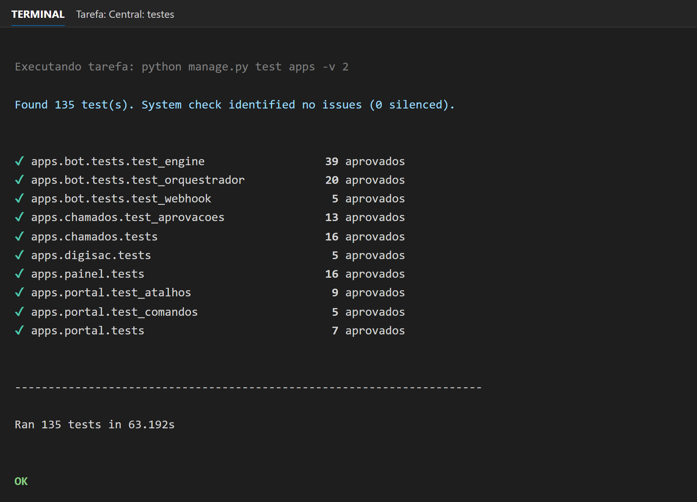

| Área | Módulo | Testes | Resultado |
|---|---|---|---|
| Motor da conversa | `apps.bot.tests.test_engine` | 39 | ✅ |
| Orquestrador (banco + chamados + canais) | `apps.bot.tests.test_orquestrador` | 20 | ✅ |
| Webhook do WhatsApp | `apps.bot.tests.test_webhook` | 5 | ✅ |
| Cliente e conferência do Digisac | `apps.digisac.tests` | 5 | ✅ |
| SLA em horas úteis e feriados | `apps.chamados.tests` | 16 | ✅ |
| Aprovação do coordenador e do gerente | `apps.chamados.test_aprovacoes` | 13 | ✅ |
| Painel, exportação Excel e simulador | `apps.painel.tests` | 16 | ✅ |
| Portal web (chat) | `apps.portal.tests` | 7 | ✅ |
| Portas do Codespaces e proteção CSRF | `apps.portal.test_atalhos` | 9 | ✅ |
| Comandos sem PowerShell | `apps.portal.test_comandos` | 5 | ✅ |
| **Total** | | **135** | ✅ **135 aprovados, 0 falhas, 0 erros** |

A lista de todos os 135 testes está no [Apêndice](#apêndice-lista-completa-dos-135-testes).

> As linhas `ERROR apps.canais.whatsapp: Falha ao enviar mensagem pelo WhatsApp` e
> `WARNING apps.portal.csrf: CSRF recusado` no log são **esperadas**: os testes simulam de propósito
> o provedor fora do ar e um envio sem cookie de segurança, e confirmam que o sistema reage certo.

---

## 5. Testes de interface (com imagens)

Roteiro executado no Edge contra a Central rodando em `http://127.0.0.1:8100` com o banco de
demonstração. Cada passo confere o que aparece na tela.

| Passo | O que foi feito | Resultado |
|---|---|---|
| T01 | Abrir o chat: o assistente cumprimenta e pede o nome | ✅ |
| T02 | Informar nome, setor, centro de custo e e-mail: o menu aparece | ✅ |
| T03 | Opção 9: aparecem os 16 itens da requisição de material | ✅ |
| T04 | Escolher Notebook e descrever: o assistente pede as duas aprovações | ✅ |
| T05 | Informar coordenador e gerente: a solicitação é registrada com protocolo | ✅ |
| T06 | Abrir o link do gerente (coordenador já aprovou): pedido e botões Aprovar/Reprovar | ✅ |
| T07 | Abrir de novo o link do coordenador: não permite decidir outra vez | ✅ |
| T08 | Abrir um link de aprovação inválido: página não encontrada (404) | ✅ |
| T09 | Login do analista e fila com todos os chamados | ✅ |
| T10 | A fila mostra os cinco estados de SLA (no prazo, atenção, vencido, aguardando, reprovado) | ✅ |
| T11 | Detalhe de chamado aguardando aprovação: etapas, link e resolução bloqueada | ✅ |
| T12 | Chamado resolvido com pesquisa "Insatisfeito" e observação | ✅ |
| T13 | Solicitação reprovada: "Sem SLA (reprovado)", sem promessa de pesquisa e sem "Reabrir" | ✅ (antes: ❌ D11, D12, D13) |
| T14 | Exportar Excel: a planilha é baixada | ✅ |
| T15 | Simulador do WhatsApp: "preciso de um cabo hdmi" leva ao item certo | ✅ |
| T16 | Administração: orientações que exigem aprovação (7 itens) | ✅ |
| T17 | Envio sem cookie de segurança: recusado com o motivo em português | ✅ |

### 5.1 Chat do colaborador

| Boas-vindas | Requisição de material (opção 9) | Aprovações e protocolo |
|---|---|---|
| 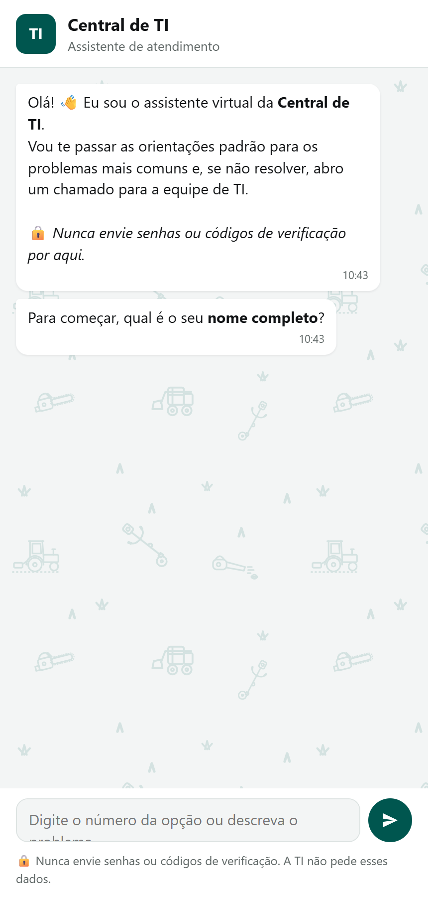 | 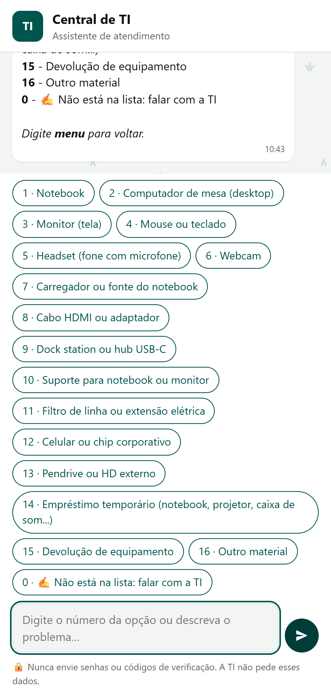 | 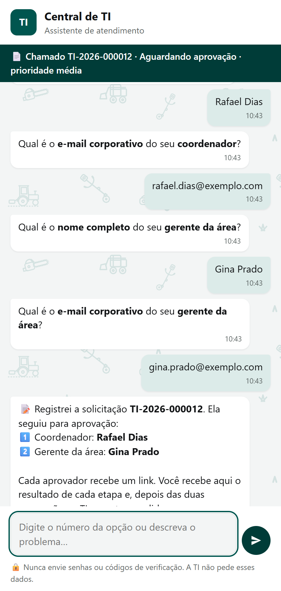 |

### 5.2 Página do aprovador (link enviado ao gerente)

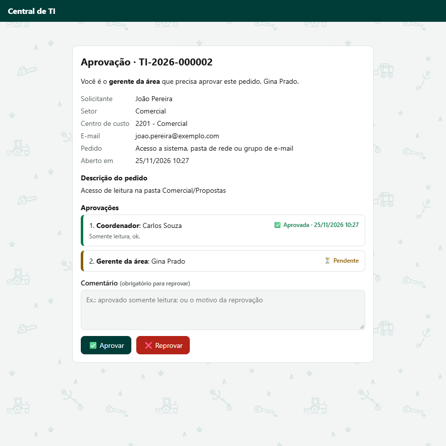

### 5.3 Painel da TI

**Fila com os estados de SLA.** Aparecem: 🔴 vencido (crítico de segurança), 🟡 atenção,
🟢 no prazo, ⏸ aguardando aprovação, ⛔ sem SLA (reprovado) e cumprido, com a pesquisa de cada
chamado resolvido:

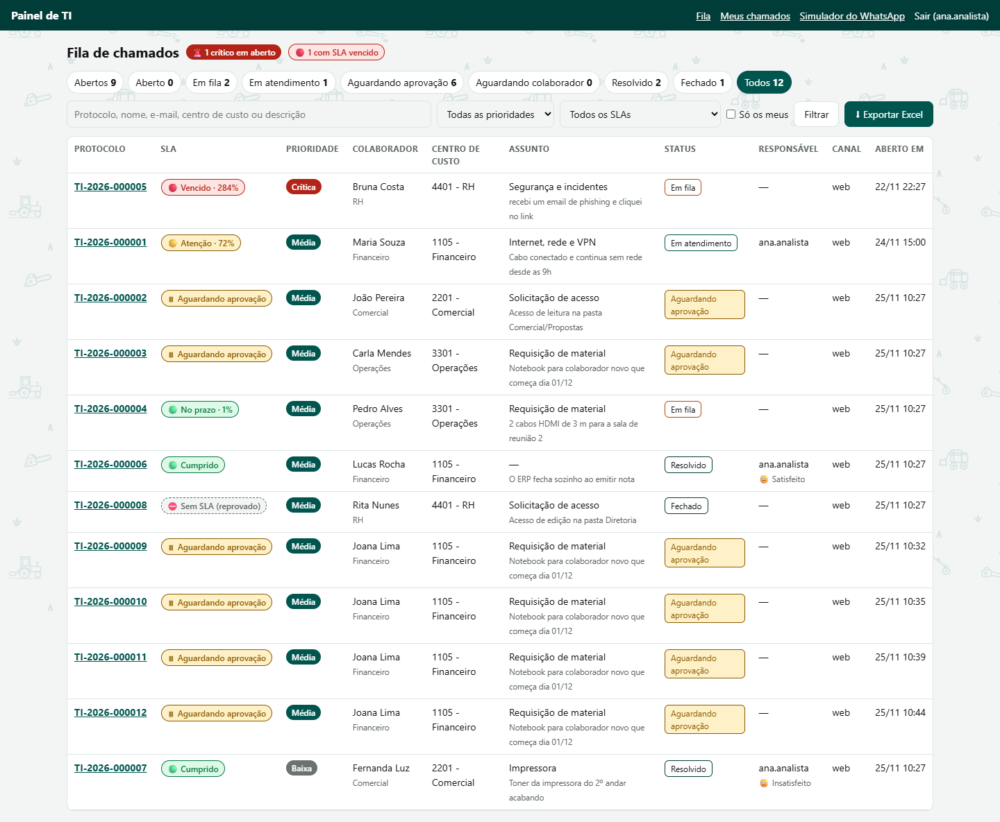

**Chamado aguardando aprovação.** O coordenador já aprovou e o link do gerente está pronto para
copiar. A resolução fica bloqueada:

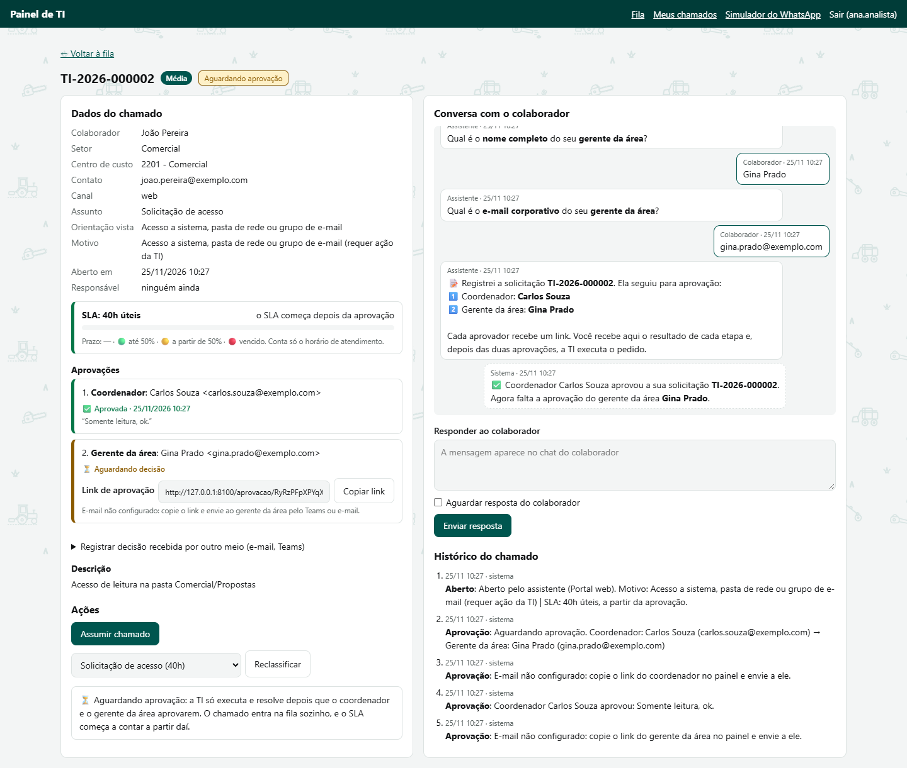

**Chamado resolvido com pesquisa negativa.** A observação é obrigatória e aparece destacada:

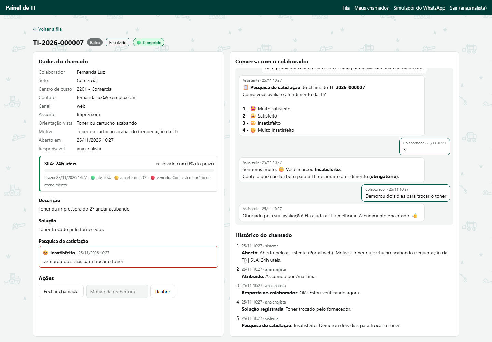

**Solicitação reprovada pelo coordenador.** A imagem já mostra o comportamento corrigido de D11 a
D16:

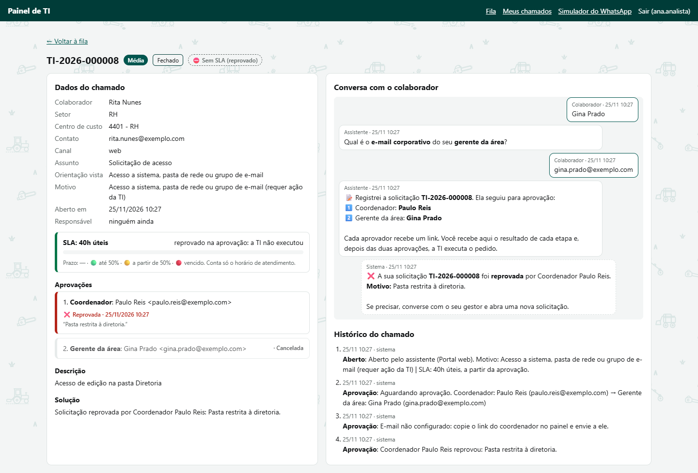

**Simulador do WhatsApp.** O texto livre encontra o item da requisição de material:

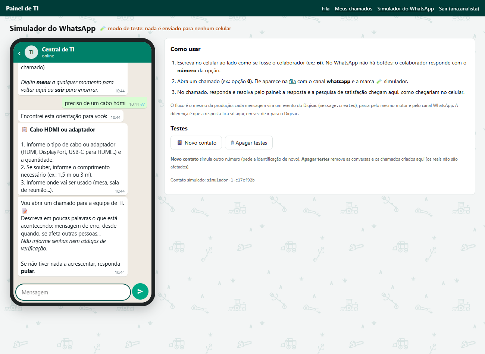

### 5.4 Administração

| Orientações que exigem aprovação | Aprovações registradas |
|---|---|
| 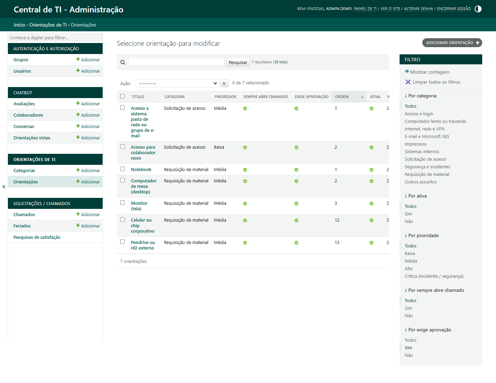 |  |

### 5.5 Proteção do formulário (CSRF)

Um envio sem o cookie de segurança é recusado, e a página explica o motivo e o que fazer (D10):

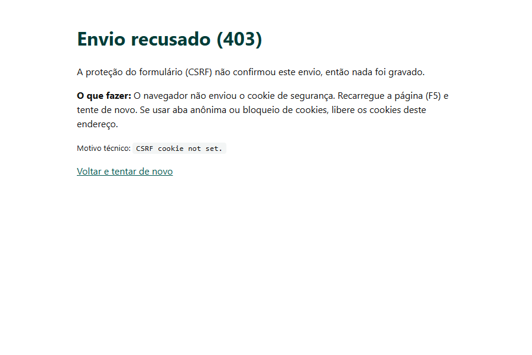

### 5.6 Excel exportado, aberto no Microsoft Excel

Indicadores conferidos no Excel: **12 chamados, 9 em aberto, 1 com SLA vencido, 2 pesquisas
respondidas, 50% de satisfação** e 4 gráficos.

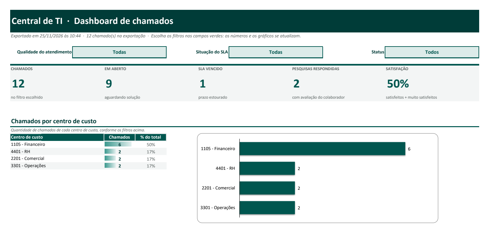

**Qualidade do atendimento e situação do SLA.** Já com os estados de aprovação (D17). Os rótulos
"0%" sobre fatias vazias são o defeito aberto D18:

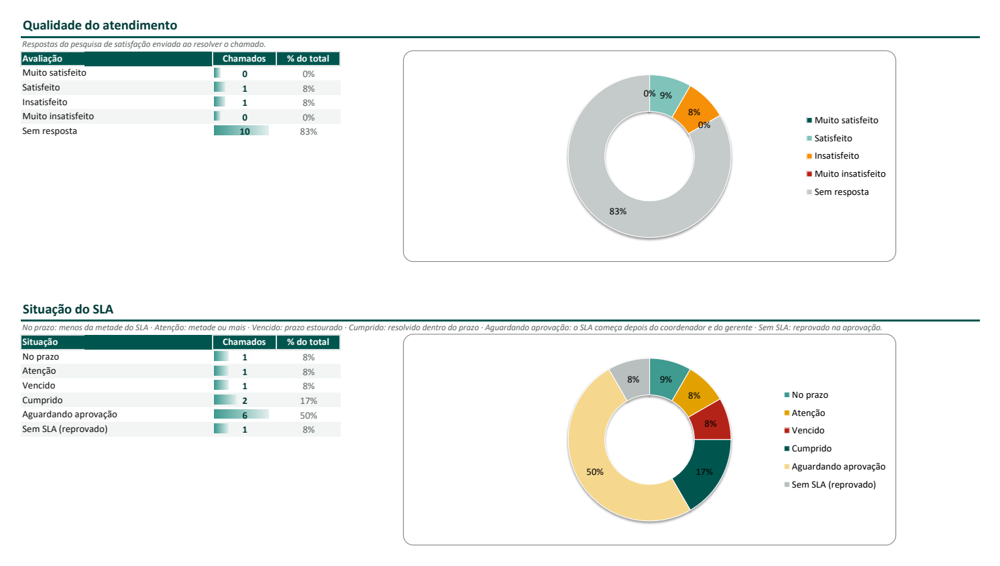

---

## 6. Registro de defeitos

Severidade: **Alta** = impede o uso; **Média** = resultado errado ou enganoso; **Baixa** = visual
ou mensagem.

| ID | Data | Onde | Defeito | Sev. | Como foi encontrado | Correção | Status |
|---|---|---|---|---|---|---|---|
| D01 | 24/11 | Testes do SLA | Testes de SLA quebraram quando o SLA passou a ler os feriados do banco (o tipo de teste usado não acessa banco) | Baixa (teste) | Suíte | Testes passaram a usar banco de teste e limpar o cache de feriados | ✅ Fechado |
| D02 | 24/11 | Migração do SLA | Num banco novo, a migração que calcula o SLA dos chamados existentes consultava feriados antes da tabela existir | Média | Suíte (banco criado do zero) | A migração calcula sem feriados (os feriados entram depois) | ✅ Fechado |
| D03 | 24/11 | Teste do SLA | Teste esperava prazo errado: 72h úteis a partir de 23/11 8h terminam em 02/12 10h | Baixa (teste) | Suíte | Expectativa do teste corrigida | ✅ Fechado |
| D04 | 24/11 | `testar_digisac` | No console do Windows, o comando quebrava ao imprimir emoji | Baixa | Execução manual | Marcadores `[ok]`, `[--]` e `[FALTA]` | ✅ Fechado |
| D05 | 24/11 | `testar_digisac` | Os textos de exemplo do `.env.example` contavam como configuração preenchida | Média | Execução manual | Conferência ignora os textos de exemplo | ✅ Fechado |
| D06 | 24/11 | Excel | Rótulos dos gráficos mostravam "Chamados; categoria; valor" | Baixa | Abertura no Excel | Rótulos só com o número ou o % | ✅ Fechado |
| D07 | 24/11 | Excel | A geração da planilha falhava na configuração de impressão | Alta | Suíte | Configuração de página criada explicitamente | ✅ Fechado |
| D08 | 24/11 | Instalação | Script de instalação não detectava o administrador existente (saída do Django 5.2) | Média | Execução manual | Corrigido; depois o script foi substituído por `python preparar.py` | ✅ Fechado |
| D09 | 24/11 | Codespaces | Portas do painel (8001) e da administração (8002) não apareciam num Codespace criado antes da atualização | Média | Relato da usuária | `ligar.sh` acerta a configuração e religa; instruções no README | ✅ Fechado |
| D10 | 24/11 | Codespaces | **Login recusado: "Verificação CSRF falhou"** nas portas 8000, 8001 e 8002 | **Alta** | Relato da usuária (print) | Portas 8001/8002 só redirecionam para a 8000 (um único endereço para login e cookies); cookies com nome próprio no Codespaces; origens exatas liberadas; página de erro com o motivo | ✅ Fechado no código e no teste real (T17 e envio de login pelo servidor). **Falta a confirmação da usuária no Codespace dela** |
| D11 | 25/11 | SLA | Solicitação **reprovada** aparecia com SLA **"Cumprido"** (a TI nunca executou) | Média | Roteiro de interface | Novo estado **"Sem SLA (reprovado)"** | ✅ Fechado (T13) |
| D12 | 25/11 | Painel: detalhe | Reprovada dizia "Pesquisa enviada; ainda sem resposta", mas nenhuma pesquisa é enviada | Baixa | Revisão das imagens | Mensagem só para chamados resolvidos pela TI | ✅ Fechado |
| D13 | 25/11 | Painel: detalhe | Botão "Reabrir" aparecia na reprovada, mas reabrir é bloqueado (só dava erro) | Baixa | Revisão das imagens | Botão escondido para reprovadas | ✅ Fechado |
| D14 | 25/11 | Painel: conversa | Mensagens do assistente apareciam com asteriscos crus (`*nome completo*`) | Baixa | Revisão das imagens | Formatação do WhatsApp (negrito, itálico, riscado), escapando o HTML antes | ✅ Fechado |
| D15 | 25/11 | Painel: detalhe | "Aguardando aprovação" repetido no cabeçalho (status e selo do SLA) | Baixa | Revisão das imagens | Selo do SLA só aparece quando o SLA corre | ✅ Fechado |
| D16 | 25/11 | Painel: detalhe | Título "Ações" vazio na solicitação reprovada | Baixa | Revisão das imagens | Título escondido quando não há ação | ✅ Fechado |
| D17 | 25/11 | Excel: dashboard | "Situação do SLA" sem "Aguardando aprovação" e "Sem SLA": 6 de 11 chamados ficavam de fora e os % somavam 45% | Média | Abertura no Excel | Os dois estados entraram na tabela, no gráfico e no filtro | ✅ Fechado (teste `ExcelComAprovacaoTest`) |
| D18 | 25/11 | Excel: dashboard | Gráfico de rosca mostra rótulo "0%" sobre fatias vazias | Baixa | Abertura no Excel | Tentativa com formato numérico do rótulo: o Excel ignorou e a tentativa foi desfeita | ⏳ **Aberto** |
| D19 | 25/11 | Painel: fila | O filtro "🟢 No prazo" incluía pedidos aguardando aprovação e reprovados | Baixa | Análise do D11 | Esses pedidos ficam fora dos filtros de cor | ✅ Fechado |

### 6.1 Detalhe do defeito D10 (login recusado no Codespaces)

- **Sintoma:** ao entrar no painel pelo Codespaces, aparecia "Proibido (403). Verificação CSRF
  falhou. Pedido cancelado." nas três portas.
- **Causa:**
  - Para o navegador, cada porta é um endereço diferente, com os seus próprios cookies de segurança.
  - Pelo VS Code instalado no computador, as portas viram `localhost` e passam a dividir os mesmos
    cookies, inclusive com a Central do Windows.
  - Por isso, entrar numa porta invalidava o login aberto na outra.
- **Correção:**
  - As portas 8001 e 8002 só levam ao painel e à administração na porta 8000, onde fica o login.
  - No Codespaces, os cookies ganharam nomes próprios.
  - Os endereços exatos das portas foram liberados.
  - A página de erro passou a mostrar o motivo técnico.
- **Verificação:**
  - Testes `LoginComCookiesProprios` e `AtalhoPorPorta`.
  - Envio de login pelo servidor real passando pelas portas de atalho.
  - Passo T17.

### 6.2 Ocorrências do próprio teste (não são defeitos do sistema)

| Ocorrência | O que aconteceu | Ação |
|---|---|---|
| Roteiro digitava rápido demais | Na 1ª passada, o roteiro enviou a descrição enquanto o chat ainda respondia, e a mensagem se perdeu (uma pessoa não consegue fazer isso, porque o botão fica desabilitado) | O roteiro passou a esperar a resposta antes de digitar, como uma pessoa |
| Teste com barra invertida | Um teste novo comparava `EMPRESA\ana` com a barra mal escapada | Teste corrigido; o código estava certo |
| Usuário de teste no banco real | A criação de um administrador temporário no banco real foi **bloqueada** pelo controle de segurança | Os testes de interface passaram a usar um banco de demonstração separado, com dados fictícios |

---

## 7. Critérios de aceite das novidades

| Critério | Coberto por | Situação |
|---|---|---|
| SLA por categoria em horas úteis, sem feriados; verde, amarelo e vermelho | `apps.chamados.tests`, T10 | ✅ |
| Pesquisa ao resolver; observação obrigatória para insatisfeito e muito insatisfeito | testes do motor e do orquestrador, T12 | ✅ |
| Centro de custo separado do nome | `CentroDeCustoTest`, T02 | ✅ |
| Excel com dashboard nas cores Mensori e filtros por qualidade e centro de custo | `PainelTest`, T14, imagens 13 e 14 | ✅ |
| Criação de usuário e liberação de acesso exigem coordenador e depois gerente | `apps.chamados.test_aprovacoes`, testes do motor, T04 a T07, T11 | ✅ |
| A TI não executa antes das aprovações; o SLA só começa depois delas | `test_ti_nao_executa_antes_da_aprovacao`, T11 | ✅ |
| Requisição de material: notebook, telas, mouses, cabos HDMI e demais itens | `RequisicaoDeMaterial`, T03, T15 | ✅ |
| Rodar sem PowerShell, só com Django e VS Code | `apps.portal.test_comandos`, comandos executados nesta máquina | ✅ |
| Codespaces com portas do chat, do painel e da administração; login funcionando | `apps.portal.test_atalhos`, T17 | ✅ no teste · ⏳ confirmação da usuária |

---

## 8. Pendências e o que não foi testado

- **Acesso dos colegas pela rede:** depende de um administrador criar a regra do firewall
  (o usuário desta máquina não é administrador). Comando a entregar:
  `netsh advfirewall firewall add rule name="Central de TI" dir=in action=allow protocol=TCP localport=8000 profile=domain,private`
- **WhatsApp real (Digisac):** só testado pelo simulador e por testes automatizados. Faltam as
  credenciais do Digisac e um endereço HTTPS público para o webhook.
- **Envio real dos links de aprovação por e-mail:** testado com e-mail simulado; falta configurar a
  conta SMTP (`python manage.py configurar_integracoes --so-email`).
- **D10 no Codespaces da usuária:** corrigido e testado aqui; falta abrir um Codespace novo e
  confirmar o login.
- **D18 (rótulo "0%" no gráfico do Excel):** aberto, só visual.

---

## Apêndice: lista completa dos 135 testes

### Motor da conversa (Python puro): 39 testes

`apps.bot.tests.test_engine`

| Classe | Teste | O que verifica | Resultado |
|---|---|---|---|
| Aprovacao | `test_coordenador_e_gerente_precisam_ser_pessoas_diferentes` | coordenador e gerente precisam ser pessoas diferentes | ✅ |
| Aprovacao | `test_criacao_de_usuario_tambem_exige_aprovacao` | criacao de usuario tambem exige aprovacao | ✅ |
| Aprovacao | `test_email_do_aprovador_invalido` | email do aprovador invalido | ✅ |
| Aprovacao | `test_liberar_acesso_pede_coordenador_e_gerente` | liberar acesso pede coordenador e gerente | ✅ |
| Aprovacao | `test_nao_pode_aprovar_a_propria_solicitacao` | nao pode aprovar a propria solicitacao | ✅ |
| Aprovacao | `test_outras_orientacoes_nao_pedem_aprovacao` | outras orientacoes nao pedem aprovacao | ✅ |
| CentroDeCusto | `test_centro_de_custo_invalido` | centro de custo invalido | ✅ |
| CentroDeCusto | `test_pergunta_o_centro_de_custo_depois_do_setor` | pergunta o centro de custo depois do setor | ✅ |
| CentroDeCusto | `test_quem_ja_tinha_cadastro_so_informa_o_centro_de_custo` | quem ja tinha cadastro so informa o centro de custo | ✅ |
| Critico | `test_seguranca_escala_na_hora_com_prioridade_critica` | seguranca escala na hora com prioridade critica | ✅ |
| Critico | `test_texto_livre_de_phishing_escala` | texto livre de phishing escala | ✅ |
| DadosSensiveis | `test_mantem_frases_normais` | mantem frases normais | ✅ |
| DadosSensiveis | `test_remove_senha_codigo_e_cpf` | remove senha codigo e cpf | ✅ |
| Identificacao | `test_colaborador_conhecido_vai_direto_ao_menu` | colaborador conhecido vai direto ao menu | ✅ |
| Identificacao | `test_email_de_outro_dominio_e_recusado` | email de outro dominio e recusado | ✅ |
| Identificacao | `test_identificacao_configuravel_com_matricula` | identificacao configuravel com matricula | ✅ |
| Identificacao | `test_nome_invalido` | nome invalido | ✅ |
| Identificacao | `test_pede_nome_setor_email_e_mostra_menu` | pede nome setor email e mostra menu | ✅ |
| NaoResolvido | `test_categoria_sem_orientacao_vai_direto_para_chamado` | categoria sem orientacao vai direto para chamado | ✅ |
| NaoResolvido | `test_com_chamado_aberto_bot_fica_em_silencio` | com chamado aberto bot fica em silencio | ✅ |
| NaoResolvido | `test_fora_do_horario_informa_janela_configurada` | fora do horario informa janela configurada | ✅ |
| NaoResolvido | `test_nao_por_texto` | nao por texto | ✅ |
| NaoResolvido | `test_pede_descricao_e_abre_chamado_com_resumo` | pede descricao e abre chamado com resumo | ✅ |
| NaoResolvido | `test_solicitacao_de_acesso_sempre_abre_chamado` | solicitacao de acesso sempre abre chamado | ✅ |
| Navegacao | `test_comandos_globais` | comandos globais | ✅ |
| Navegacao | `test_nao_muta_estado_de_entrada` | nao muta estado de entrada | ✅ |
| Navegacao | `test_tres_opcoes_invalidas_oferece_chamado` | tres opcoes invalidas oferece chamado | ✅ |
| Navegacao | `test_ver_outra_orientacao` | ver outra orientacao | ✅ |
| RequisicaoDeMaterial | `test_aparece_no_menu_antes_de_outros_com_todos_os_itens` | aparece no menu antes de outros com todos os itens | ✅ |
| RequisicaoDeMaterial | `test_demais_itens_abrem_chamado_direto` | demais itens abrem chamado direto | ✅ |
| RequisicaoDeMaterial | `test_itens_de_valor_ou_risco_exigem_aprovacao` | itens de valor ou risco exigem aprovacao | ✅ |
| RequisicaoDeMaterial | `test_texto_livre_acha_o_item` | texto livre acha o item | ✅ |
| RequisicaoDeMaterial | `test_toner_abre_chamado_na_impressora` | toner abre chamado na impressora | ✅ |
| Resolvido | `test_resolve_avalia_e_encerra` | resolve avalia e encerra | ✅ |
| Resolvido | `test_sim_por_texto` | sim por texto | ✅ |
| TextoLivre | `test_descricao_clara_vai_direto_para_a_orientacao` | descricao clara vai direto para a orientacao | ✅ |
| TextoLivre | `test_erro_de_acesso_sugere_orientacoes` | erro de acesso sugere orientacoes | ✅ |
| TextoLivre | `test_relato_vira_descricao_sem_repetir` | relato vira descricao sem repetir | ✅ |
| TextoLivre | `test_sem_resultado_conta_como_tentativa` | sem resultado conta como tentativa | ✅ |

### Orquestrador (banco + chamados + canais): 20 testes

`apps.bot.tests.test_orquestrador`

| Classe | Teste | O que verifica | Resultado |
|---|---|---|---|
| CentroDeCustoTest | `test_chamado_guarda_o_centro_de_custo_separado` | chamado guarda o centro de custo separado | ✅ |
| OrquestradorTest | `test_analista_responde_e_resolve` | analista responde e resolve | ✅ |
| OrquestradorTest | `test_canal_whatsapp_desligado_nao_afeta_o_portal` | canal whatsapp desligado nao afeta o portal | ✅ |
| OrquestradorTest | `test_chamado_nao_duplica_na_mesma_conversa` | chamado nao duplica na mesma conversa | ✅ |
| OrquestradorTest | `test_chamado_recebe_sla_da_categoria` | chamado recebe sla da categoria | ✅ |
| OrquestradorTest | `test_chamado_sem_categoria_usa_sla_de_outros` | chamado sem categoria usa sla de outros | ✅ |
| OrquestradorTest | `test_conversa_inativa_expira` | conversa inativa expira | ✅ |
| OrquestradorTest | `test_falha_do_whatsapp_nao_perde_mensagens` | falha do whatsapp nao perde mensagens | ✅ |
| OrquestradorTest | `test_fora_do_horario_fica_na_fila_sem_perder_mensagens` | fora do horario fica na fila sem perder mensagens | ✅ |
| OrquestradorTest | `test_incidente_critico_tem_prioridade_critica` | incidente critico tem prioridade critica | ✅ |
| OrquestradorTest | `test_mensagem_repetida_nao_duplica` | mensagem repetida nao duplica | ✅ |
| OrquestradorTest | `test_nao_resolvido_abre_chamado_com_protocolo` | nao resolvido abre chamado com protocolo | ✅ |
| OrquestradorTest | `test_pesquisa_espera_mais_que_o_timeout_normal` | pesquisa espera mais que o timeout normal | ✅ |
| OrquestradorTest | `test_pesquisa_expirada_nao_muda_resultado` | pesquisa expirada nao muda resultado | ✅ |
| OrquestradorTest | `test_pesquisa_insatisfeito_exige_observacao` | pesquisa insatisfeito exige observacao | ✅ |
| OrquestradorTest | `test_pesquisa_resposta_invalida_pergunta_de_novo` | pesquisa resposta invalida pergunta de novo | ✅ |
| OrquestradorTest | `test_pesquisa_satisfeito_com_observacao_opcional` | pesquisa satisfeito com observacao opcional | ✅ |
| OrquestradorTest | `test_registrar_pesquisa_valida_observacao` | registrar pesquisa valida observacao | ✅ |
| OrquestradorTest | `test_resolvido_registra_avaliacao_e_encerra` | resolvido registra avaliacao e encerra | ✅ |
| OrquestradorTest | `test_senha_nao_e_gravada` | senha nao e gravada | ✅ |

### Webhook do WhatsApp (Digisac): 5 testes

`apps.bot.tests.test_webhook`

| Classe | Teste | O que verifica | Resultado |
|---|---|---|---|
| InterpretarWebhook | `test_fechamento_de_ticket` | fechamento de ticket | ✅ |
| InterpretarWebhook | `test_lista_de_mensagens` | lista de mensagens | ✅ |
| InterpretarWebhook | `test_mensagem_do_atendente_ou_bot` | mensagem do atendente ou bot | ✅ |
| InterpretarWebhook | `test_mensagem_do_colaborador` | mensagem do colaborador | ✅ |
| InterpretarWebhook | `test_outros_eventos_e_lixo` | outros eventos e lixo | ✅ |

### Cliente e conferência do Digisac: 5 testes

`apps.digisac.tests`

| Classe | Teste | O que verifica | Resultado |
|---|---|---|---|
| WebhookTest | `test_canal_desligado_ignora` | canal desligado ignora | ✅ |
| WebhookTest | `test_exige_token` | exige token | ✅ |
| WebhookTest | `test_reenvio_do_webhook_nao_duplica` | reenvio do webhook nao duplica | ✅ |
| TestarDigisacTest | `test_configuracao_completa` | configuracao completa | ✅ |
| TestarDigisacTest | `test_valores_de_exemplo_contam_como_faltando` | valores de exemplo contam como faltando | ✅ |

### SLA em horas úteis e feriados: 16 testes

`apps.chamados.tests`

| Classe | Teste | O que verifica | Resultado |
|---|---|---|---|
| Cores | `test_amarelo_a_partir_da_metade` | amarelo a partir da metade | ✅ |
| Cores | `test_resolvido_congela_o_sla` | resolvido congela o sla | ✅ |
| Cores | `test_resolvido_depois_do_prazo_fica_vencido` | resolvido depois do prazo fica vencido | ✅ |
| Cores | `test_verde_antes_da_metade` | verde antes da metade | ✅ |
| Cores | `test_vermelho_quando_vence` | vermelho quando vence | ✅ |
| Feriados | `test_cadastrar_feriado_no_admin_atualiza_na_hora` | cadastrar feriado no admin atualiza na hora | ✅ |
| Feriados | `test_feriado_nao_conta_nas_horas_consumidas` | feriado nao conta nas horas consumidas | ✅ |
| Feriados | `test_feriado_nao_conta_no_prazo` | feriado nao conta no prazo | ✅ |
| Feriados | `test_feriados_nacionais` | feriados nacionais | ✅ |
| Feriados | `test_migracao_cadastrou_os_feriados_nacionais` | migracao cadastrou os feriados nacionais | ✅ |
| HorasUteis | `test_72h_uteis_sao_sete_dias_uteis_e_duas_horas` | 72h uteis sao sete dias uteis e duas horas | ✅ |
| HorasUteis | `test_aberto_a_noite_comeca_a_contar_as_8h` | aberto a noite comeca a contar as 8h | ✅ |
| HorasUteis | `test_fim_de_semana_nao_conta` | fim de semana nao conta | ✅ |
| HorasUteis | `test_horas_entre_descontam_noite_e_fim_de_semana` | horas entre descontam noite e fim de semana | ✅ |
| HorasUteis | `test_soma_dentro_do_mesmo_dia` | soma dentro do mesmo dia | ✅ |
| HorasUteis | `test_soma_passa_para_o_dia_seguinte` | soma passa para o dia seguinte | ✅ |

### Aprovação do coordenador e do gerente: 13 testes

`apps.chamados.test_aprovacoes`

| Classe | Teste | O que verifica | Resultado |
|---|---|---|---|
| AprovacaoTest | `test_chamado_aguarda_aprovacao_sem_contar_sla` | chamado aguarda aprovacao sem contar sla | ✅ |
| AprovacaoTest | `test_coordenador_e_gerente_aprovam_e_chamado_entra_na_fila` | coordenador e gerente aprovam e chamado entra na fila | ✅ |
| AprovacaoTest | `test_fila_mostra_status_aguardando_aprovacao` | fila mostra status aguardando aprovacao | ✅ |
| AprovacaoTest | `test_gerente_so_decide_depois_do_coordenador` | gerente so decide depois do coordenador | ✅ |
| AprovacaoTest | `test_link_decidido_nao_decide_de_novo` | link decidido nao decide de novo | ✅ |
| AprovacaoTest | `test_link_invalido` | link invalido | ✅ |
| AprovacaoTest | `test_painel_mostra_aprovacoes_e_registra_decisao_com_evidencia` | painel mostra aprovacoes e registra decisao com evidencia | ✅ |
| AprovacaoTest | `test_reprovacao_exige_motivo_e_encerra` | reprovacao exige motivo e encerra | ✅ |
| AprovacaoTest | `test_ti_nao_executa_antes_da_aprovacao` | ti nao executa antes da aprovacao | ✅ |
| EmailAprovacaoTest | `test_links_vao_por_email_um_de_cada_vez` | links vao por email um de cada vez | ✅ |
| ExcelComAprovacaoTest | `test_dashboard_conta_aguardando_e_reprovado` | dashboard conta aguardando e reprovado | ✅ |
| TestarEmailTest | `test_aponta_o_que_falta` | aponta o que falta | ✅ |
| TestarEmailTest | `test_envia_email_de_teste` | envia email de teste | ✅ |

### Painel da TI, exportação Excel e simulador: 16 testes

`apps.painel.tests`

| Classe | Teste | O que verifica | Resultado |
|---|---|---|---|
| FormatacaoWhatsAppTest | `test_negrito_sem_abrir_brecha_de_html` | negrito sem abrir brecha de html | ✅ |
| PainelTest | `test_analista_ve_fila_e_historico` | analista ve fila e historico | ✅ |
| PainelTest | `test_atender_responder_e_resolver` | atender responder e resolver | ✅ |
| PainelTest | `test_detalhe_mostra_pesquisa_respondida` | detalhe mostra pesquisa respondida | ✅ |
| PainelTest | `test_excel_tem_dashboard_com_filtros_e_graficos` | excel tem dashboard com filtros e graficos | ✅ |
| PainelTest | `test_exige_login` | exige login | ✅ |
| PainelTest | `test_exportar_excel_com_os_campos_pedidos` | exportar excel com os campos pedidos | ✅ |
| PainelTest | `test_exportar_respeita_filtro_e_permissao` | exportar respeita filtro e permissao | ✅ |
| PainelTest | `test_fila_e_detalhe_mostram_sla` | fila e detalhe mostram sla | ✅ |
| PainelTest | `test_filtro_e_alerta_de_sla_vencido` | filtro e alerta de sla vencido | ✅ |
| PainelTest | `test_painel_mostra_centro_de_custo` | painel mostra centro de custo | ✅ |
| PainelTest | `test_reclassificar_muda_o_sla` | reclassificar muda o sla | ✅ |
| PainelTest | `test_usuario_sem_perfil_nao_acessa` | usuario sem perfil nao acessa | ✅ |
| SimuladorWhatsAppTest | `test_ciclo_completo_sem_enviar_nada_ao_digisac` | ciclo completo sem enviar nada ao digisac | ✅ |
| SimuladorWhatsAppTest | `test_exige_login` | exige login | ✅ |
| SimuladorWhatsAppTest | `test_novo_contato_e_apagar_testes` | novo contato e apagar testes | ✅ |

### Portal web (chat): 7 testes

`apps.portal.tests`

| Classe | Teste | O que verifica | Resultado |
|---|---|---|---|
| PortalTest | `test_clique_duplo_nao_duplica` | clique duplo nao duplica | ✅ |
| PortalTest | `test_colaborador_nao_ve_conversa_de_outro` | colaborador nao ve conversa de outro | ✅ |
| PortalTest | `test_fluxo_completo_ate_o_protocolo` | fluxo completo ate o protocolo | ✅ |
| PortalTest | `test_limite_de_mensagens` | limite de mensagens | ✅ |
| PortalTest | `test_pagina_abre` | pagina abre | ✅ |
| PortalTest | `test_resposta_do_analista_aparece_no_chat` | resposta do analista aparece no chat | ✅ |
| PortalTest | `test_validacao_de_entrada` | validacao de entrada | ✅ |

### Portas do Codespaces e proteção CSRF: 9 testes

`apps.portal.test_atalhos`

| Classe | Teste | O que verifica | Resultado |
|---|---|---|---|
| AtalhoPorPorta | `test_localhost_do_vscode_mantem_o_nome` | localhost do vscode mantem o nome | ✅ |
| AtalhoPorPorta | `test_no_codespaces_usa_o_endereco_publico_da_8000` | no codespaces usa o endereco publico da 8000 | ✅ |
| AtalhoPorPorta | `test_porta_do_painel_e_da_administracao_levam_para_a_8000` | porta do painel e da administracao levam para a 8000 | ✅ |
| AtalhoPorPorta | `test_porta_principal_continua_no_chat` | porta principal continua no chat | ✅ |
| AtalhoPorPorta | `test_qualquer_caminho_das_portas_extras_vai_para_a_8000` | qualquer caminho das portas extras vai para a 8000 | ✅ |
| FalhaCsrf | `test_mostra_o_motivo_em_portugues` | mostra o motivo em portugues | ✅ |
| LoginComCookiesProprios | `test_login_no_painel_com_verificacao_csrf` | login no painel com verificacao csrf | ✅ |
| SemAtalhos | `test_desligado_por_padrao` | desligado por padrao | ✅ |
| LerAtalhos | `test_le_e_ignora_itens_invalidos` | le e ignora itens invalidos | ✅ |

### Comandos sem PowerShell (servico, .env, integrações): 5 testes

`apps.portal.test_comandos`

| Classe | Teste | O que verifica | Resultado |
|---|---|---|---|
| ArquivoEnv | `test_grava_mantendo_comentarios_e_acrescenta_no_fim` | grava mantendo comentarios e acrescenta no fim | ✅ |
| ArquivoEnv | `test_le_valor_e_ignora_texto_de_exemplo` | le valor e ignora texto de exemplo | ✅ |
| ConfigurarIntegracoes | `test_exige_terminal_interativo` | exige terminal interativo | ✅ |
| ServicoWindows | `test_fora_do_windows_explica_o_que_fazer` | fora do windows explica o que fazer | ✅ |
| ServicoWindows | `test_tarefa_liga_ao_entrar_e_religa_se_cair` | tarefa liga ao entrar e religa se cair | ✅ |
